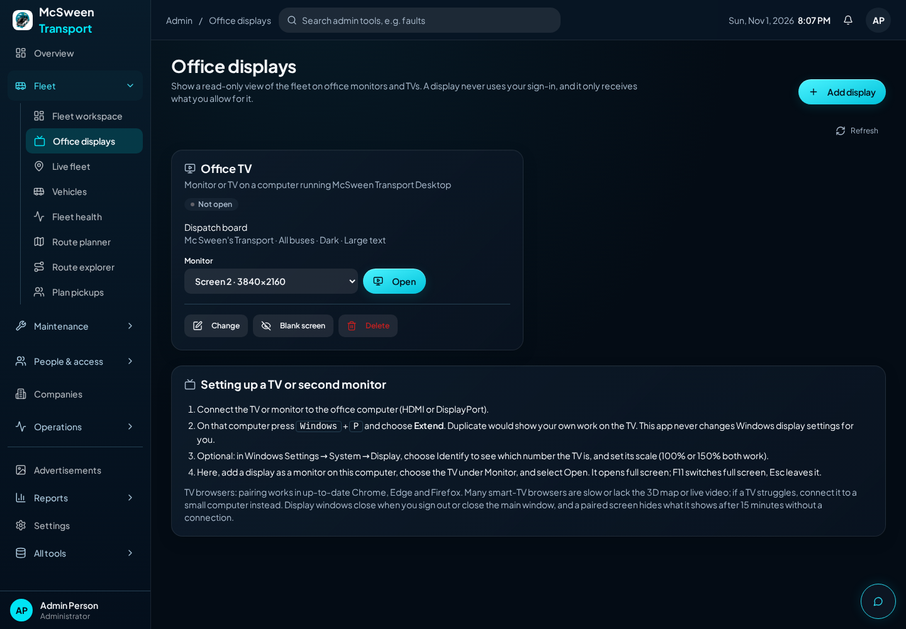
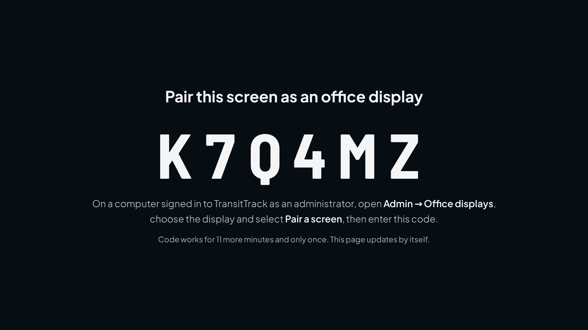
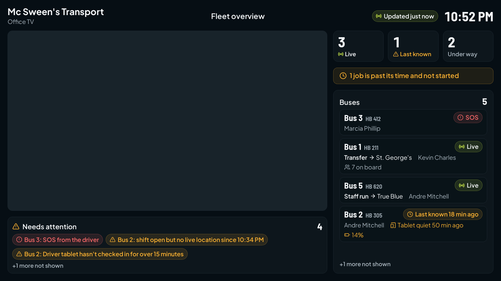
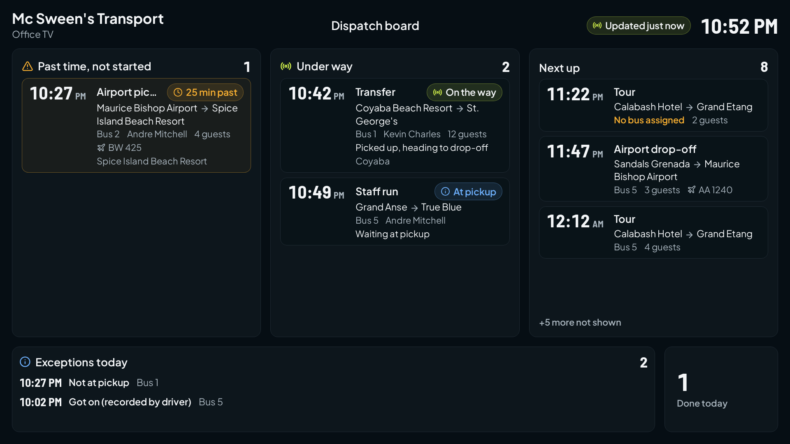
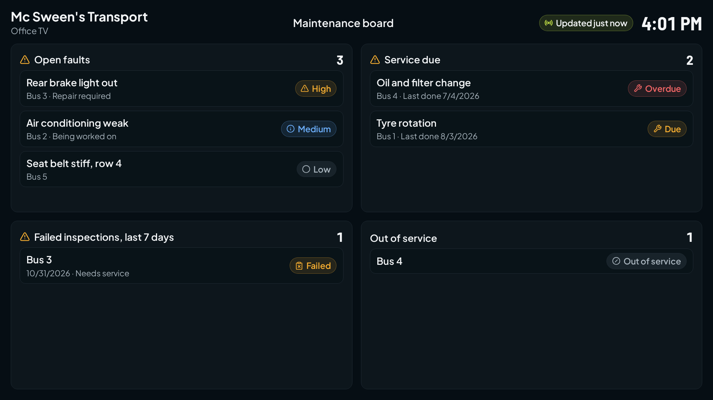
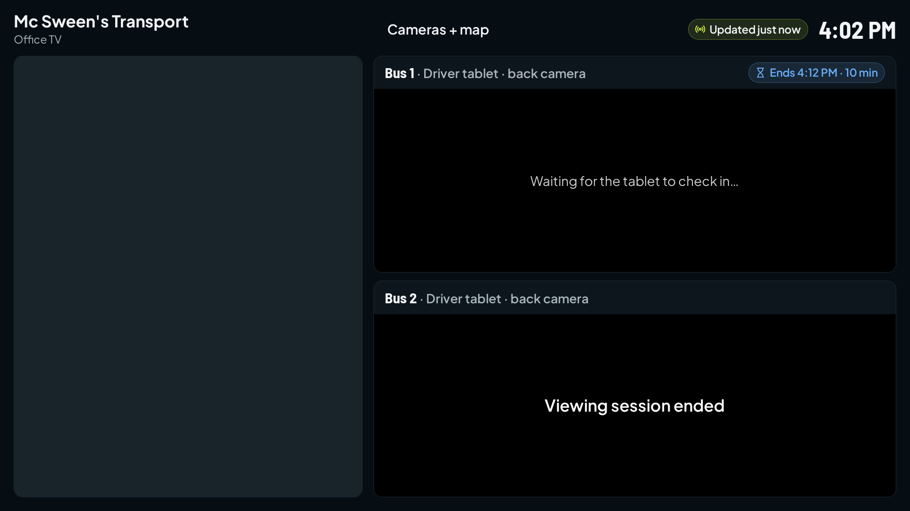
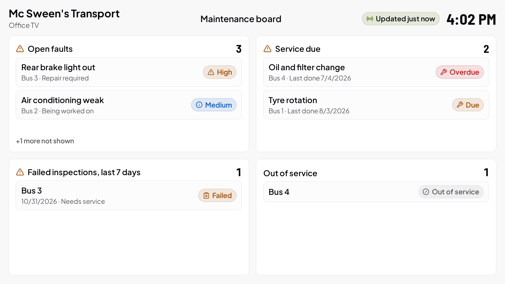
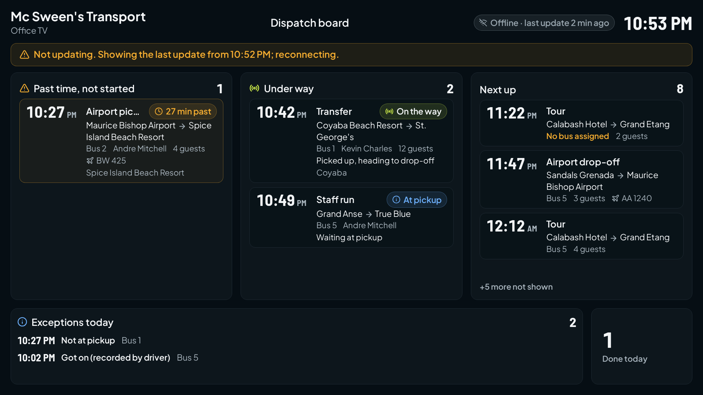

# Office displays

Office monitors and TVs that show a read-only view of the fleet: a map, today's
jobs, maintenance, and (when an administrator starts them) bus back cameras.
Set up in **Admin → Office displays**.

A display is its own screen, not a mirror of an administrator's work. It never
uses anyone's sign-in, and it receives only what its settings allow, decided on
the server (`base44/functions/officeDisplay`, rules in
`base44/shared/officeDisplay.ts`).

Screenshots below come from the automated tests with sample data. The map in them
is the basic fallback map because test runs have no map tiles; on a normal
computer the 3D map is shown.

## Two kinds of display

| | Monitor or TV on this computer | Paired screen |
|---|---|---|
| What | A TV or second monitor plugged into the office PC | Another computer, or a TV's own web browser |
| Needs | McSween Transport Desktop for Windows (0.2.8 or later) | A modern browser |
| Access | Two hours, renewed every 20 minutes while an administrator is signed in to the desktop app | 30 days from pairing, until revoked or paired again |
| Ends when | The window closes, the main window closes, you sign out, or you lose administrator access | Revoked, deleted, paired to another screen, or the approving administrator loses administrator access |

## Set up a TV on the office computer

1. Connect the TV (HDMI or DisplayPort).
2. Press **Windows + P** and choose **Extend**. Duplicate would show your own work
   on the TV. The app never changes Windows display settings.
3. In McSween Transport Desktop open **Devices → Office displays** (or Admin →
   Office displays), choose **Add display**, keep **A monitor or TV on this
   computer**, pick a layout and companies, and save.
4. Under **Monitor**, choose the TV (the app suggests the screen that isn't your
   main one) and select **Open**. The display opens full screen on the TV.

On the display window: **F11** switches full screen, **Esc** leaves it, **F5**
reloads. From the settings page: Open / Move to this monitor, Full screen,
Refresh, Close. The app remembers each display's monitor and position. If the TV
is unplugged the window moves to a screen that is still connected, and moves back
when the TV returns. Only one window per display can be open; opening it again
moves or refreshes the existing one.

## Pair another computer or a TV browser

1. Add a display and choose **Another computer or a TV browser**.
2. On the screen, open **app.mcsweenstransport.com/display/pair**. It shows a
   6-character code that works once, for 10 minutes.
3. Enter the code in the **Pair a screen** box that opens after saving (or the
   display's **Pair a screen** button).

Pairing never starts cameras. **Revoke access** blanks the screen straight away.
Pairing a different screen to the same display replaces the old one.

## Layouts

**Fleet overview**: map, buses live / last known, jobs under way, jobs past
their time and not started, and alerts (SOS, shift open without live location,
driver tablet not checking in, low tablet battery). On-board counts appear only
where a boarding tablet is reporting, the same rule as Admin → Fleet workspace.

**Dispatch board**: today's jobs past their time and not started, under way, next
up; exceptions recorded today; jobs done today.

**Maintenance board**: open faults by severity, service due or overdue, failed
inspections in the last 7 days, buses out of service.

**Cameras + map**: the map beside up to four bus back cameras.

Rotation can switch between Fleet, Dispatch and Maintenance every 30 s to 5 min.
Cameras never rotate in. On the display, Space pauses rotation and the arrow keys
step through; a Pause button appears when the mouse moves.

Appearance per display: Dark or Light, Normal / Large / Extra large text,
Comfortable or Compact. Layouts scale with the screen (1080p, 4K, Windows scaling
at 100–150%) and never scroll; when a list doesn't fit it says "+N more not
shown".

## What a display is sent

Never: phone numbers, home or pickup addresses, signatures, notes, prices, card
numbers, PINs, entry codes, company access codes, Wi-Fi details, emails, or
passenger photos. Boardings arrive as anonymous keys, used only to count.

By setting: driver names (on by default), client names (on), guest and
passenger names (off by default; turn on only where only staff can see the
screen). A blanked screen receives nothing but its own name.

Nothing is invented: no ETAs, delays or occupancy estimates. "Past its time,
not started" is a fact from the job's scheduled time and status.

## Cameras

- Choose up to four driver tablets in the display's settings. This starts nothing.
- **Start viewing (10 min)** on the display's card starts the views. They use the
  existing direct viewing (Admin → Fleet uses the same), video only, muted.
- Each view ends after 10 minutes on the server and on the tablet, even if the
  screen keeps asking. The panel then says **Viewing session ended**; the map and
  everything else stay.
- Nothing restarts a view by itself: not a reconnect, a reload, rotation or an app
  restart. A reloaded screen can't pick a view back up; an administrator starts a
  new one.
- Views stop when the display is blanked, revoked, closed, deleted, its layout or
  buses change, or the administrator who started them loses access.
- Every start, viewer connection and stop is in the audit log. Nothing is recorded.

## When the connection drops

The screen keeps the last update with a warning ("Not updating. Showing the last
update from 3:41 PM; reconnecting"), retries (5 s, 10 s, 20 s, 30 s, then every
minute) and checks again straight away when the computer wakes or comes back
online. After 15 minutes without an update it hides everything and says
"Connection lost" until it reconnects.

## Compatibility

- Tested automatically in Chromium at 1920×1080, 3840×2160 and 1280×720 (a 1080p
  screen at 150% scaling). See "Testing" for what that does and doesn't cover.
- Paired screens: up-to-date Chrome, Edge and Firefox on a computer should work.
  Smart-TV browsers vary a lot and haven't been tested. Many lack the 3D map
  (they get the basic map) or live video. If a TV struggles, plug it into a small
  computer and use a monitor display instead. There is no claim that every TV works.

## Testing

Automated (simulated: no real monitors, TVs or tablets):

| Suite | What it covers |
|---|---|
| `security-tests/office-display.test.js` (24) | Admin-only management; a display credential can't call admin actions; credentials stored only as hashes; refused when unknown, closed, revoked, expired or the issuer lost access; what a feed contains and leaves out; blanking; partial failures; pairing (single use, expiry, rate limit, re-pairing); cameras (explicit start, own display only, no resume, 10-minute server expiry, stops on blank/revoke/close/layout change/lost access, busy camera refused) |
| `src/lib/__tests__/officeDisplay.test.js` (11) | Screen scaling, connection states, retry back-off, rotation rules, stored credential, fleet rows and alerts, dispatch columns |
| `e2e/office-display.spec.js` (13) | Pairing in a browser, all four layouts at 1080p, 4K and 150% scaling with no cut-off rows, rotation and pause, stopping updates / hiding after 15 min / recovering, access ending, blanking, camera panels, the Windows bridge, light theme and extra-large text |
| `e2e/office-displays-admin.spec.js` (4) | Every button on Admin → Office displays: add, validation, open on a chosen monitor, full screen, refresh, close, pair (wrong and right code), revoke, start and stop cameras, blank, change, delete, phone width |
| `desktop/displays.test.cjs` (8) + `desktop/main.test.cjs` | Isolated display windows (own in-memory session, sandboxed, locked to /display, no permissions), credential only to its own window, no duplicates, closing ends camera views first, monitor unplugged and back, resolution change, only the main window can control displays |

### Manual checklist (real hardware)

None of these have been checked on real hardware yet. Each needs doing on the
office PC after the merge.

| Check | Simulated result | Real hardware |
|---|---|---|
| Add, rename, change, open, full screen, refresh, close | Passed | Not yet checked |
| Layout changes and company/bus limits show on the TV within 15 s | Passed | Not yet checked |
| One monitor (display opens over the main window) | Not simulated | Not yet checked |
| Two monitors: display opens on the TV, main window stays usable | Passed (fake screens) | Not yet checked |
| Two display windows on two TVs | Passed (fake screens) | Not yet checked |
| Unplug the TV, plug it back in | Passed (fake screens) | Not yet checked |
| Change the TV's resolution or Windows scaling | Passed (fake screens) | Not yet checked |
| Navigate the main window while a display stays open | Not simulated | Not yet checked |
| Minimize, restore; sleep and wake the PC | Partly (wake recheck) | Not yet checked |
| Restart the app (displays close; reopen from settings) | Not simulated | Not yet checked |
| Unplug the network, plug it back | Passed (browser) | Not yet checked |
| No buses, stale GPS, server errors | Passed | Not yet checked |
| Camera: starts, plays muted, ends at 10 minutes, "Viewing session ended" | Server and panels passed; no live video in tests | Not yet checked (needs a driver tablet with direct viewing) |
| Camera: start again after it ends | Passed (server) | Not yet checked |
| Sign out: display windows close | Passed (unit) | Not yet checked |
| Revoke a paired screen while it's showing | Passed | Not yet checked |
| Pairing code expiry, wrong code, too many codes | Passed | Not yet checked |
| A TV's own browser pairs and shows a layout | Not simulated | Not yet checked |
| Leave a display running overnight: no growing memory, one request per 15 s | Not simulated | Not yet checked (Task Manager → memory) |
| Main admin pages, NFC, kiosk flows still work | Route smoke test passed for every admin page | Not yet checked |

## Rollback

- **Before the merge**: close the pull request. Nothing is live.
- **After the merge, web and server**: on GitHub open the merged pull request and
  choose **Revert**, then merge the revert. The website goes back within a few
  minutes. The `officeDisplay` function stays on Supabase but nothing calls it;
  removing it (Supabase → Edge Functions) is your call. The two new tables
  (`office_display`, `office_display_pairing`) and the new `display_id` column on
  camera sessions are harmless if left; to remove them later, ask for a cleanup
  migration rather than dropping them by hand.
- **Displays already set up**: revoke or delete them first so screens go blank
  straight away; after a revert they stop updating and hide their content within
  15 minutes.
- **Desktop app**: reinstall 0.2.7 from GitHub Releases (Desktop Windows). Your
  sign-in and settings are kept.
